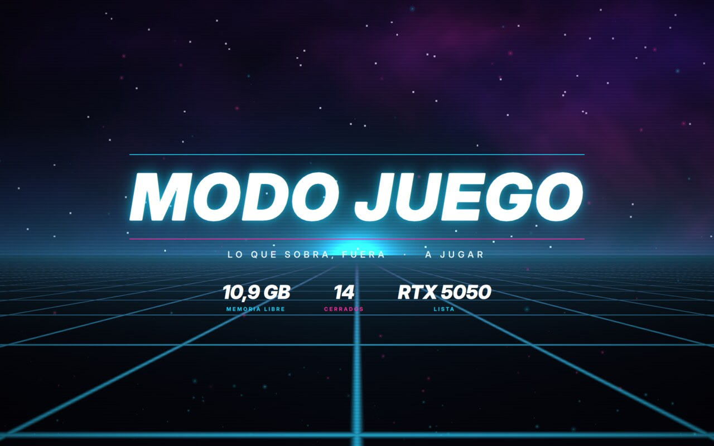

# Modo juego para niri

Un atajo que deja el equipo libre para jugar, con una entrada animada, un
lanzador de juegos al estilo consola y un compañero en el segundo monitor.
Al terminar, el mismo atajo devuelve todo a como estaba.

Está hecho para [niri](https://github.com/YaLTeR/niri) y dibujado con
[Quickshell](https://quickshell.org). La interfaz está en español.



## Qué hace

**Al activarlo (`Mod+Alt+G`)**

- Cierra los programas que le indiques (por defecto navegadores y Spotify) y
  le pide cerrarse al resto de las ventanas. Es un cierre amable: lo que
  pregunte por cambios sin guardar se queda abierto.
- Detiene servicios que no hacen falta para jugar (Docker, impresión y los
  que agregues) y apaga con calma los contenedores que estén corriendo.
- Pone el perfil de energía en rendimiento y las notificaciones en «no
  molestar».
- En portátiles ASUS con `asusctl`, el teclado destella con el golpe de la
  entrada y queda en color de juego.
- Muestra una entrada animada con sonido y los números reales de lo que
  liberó, y termina en el lanzador.

**Al desactivarlo**, vuelve a encender solo lo que estaba encendido, reabre
los programas que cerró y muestra un resumen de la sesión.

**El lanzador (`Mod+Alt+J`)**

- Tres filas: juegos, lanzadores (Steam, Battle.net, Lutris, Heroic…) y
  emuladores. Se arma solo con lo que haya en tu menú de aplicaciones en la
  categoría Juegos, lo instalado en Steam y lo de Lutris.
- **ROMs:** cada juego que dejes en una carpeta por consola aparece como un
  juego más y se abre directo con su emulador.
- Baja carátulas, fondos y logos de Steam, y de SteamGridDB para lo que
  Steam no tiene (pide una clave gratuita).
- Recuerda lo último que jugaste y cuántas horas llevas.
- **Trucos de emulador:** con `F3` sobre un juego de Wii U se encienden y
  apagan los trucos que Cemu trae para él (los paquetes de la categoría
  *Cheats*), sin abrir Cemu.
- Se maneja con teclado, ratón o mando.

**El compañero de juego**

Al abrir un juego aparece un compañero. Con dos pantallas va en la que queda
libre; con una sola se dibuja encima del juego, translúcido, y se muestra y
se oculta con `Mod+Alt+C`. Trae:

- **Guías** del juego, que cambias y desplazas con atajos sin quitarle el
  foco al juego. Con dos pantallas van en un navegador aparte. Con una sola
  se transmiten en vivo dentro del compañero y se usan con el ratón (clic,
  arrastre y rueda: sirve para mapas interactivos); para escribir en ellas,
  como en el buscador de una wiki, está el botón «Escribir en la página».
- **Un panel** con el tiempo de la sesión, temperaturas y tus notas de ese
  juego.
- **Un asistente** (opcional) al que le preguntas sobre el juego. Usa la API
  de Anthropic con búsqueda web y, si quieres, una captura de lo que estás
  viendo. Se paga por uso en tu propia cuenta.


## Estado

Está probado en un solo equipo: Arch Linux, niri 26.04, Quickshell 0.3.2,
portátil ASUS con gráfica Intel + NVIDIA y dos pantallas. En otros equipos
puede hacer falta ajustar cosas; los reportes son bienvenidos.

## Requisitos

| Hace falta | Para qué |
|---|---|
| niri | el escritorio |
| Quickshell 0.2 o más nuevo (`qs`) | la animación, el lanzador y el compañero |
| jq, python3, ImageMagick | el script, el catálogo y las carátulas |

| Opcional | Para qué |
|---|---|
| PipeWire (`pw-play`) | los sonidos |
| un navegador tipo Chromium | las guías del compañero |
| grim | la captura que acompaña las preguntas al asistente |
| python-evdev | manejar el lanzador con mando |
| power-profiles-daemon | perfil de rendimiento al jugar |
| MangoHud | contador de FPS en los juegos |
| asusctl | que el teclado reaccione (portátiles ASUS) |
| DankMaterialShell | «no molestar» |
| fuente Inter | se ve como en las imágenes |

No hace falta instalarlos antes: el instalador revisa qué falta y ofrece
instalarlo.

## Instalación

```bash
git clone https://github.com/darylgcode-prog/modo-juego-niri.git
cd modo-juego-niri
./install.sh
```

El instalador revisa qué falta, muestra la orden exacta con que se instala
y pregunta antes de ejecutarla: primero lo necesario y después, aparte, lo
recomendado. Instalar paquetes es lo único que pide tu contraseña; lo demás
va a tu carpeta personal (`~/.local/bin`, `~/.config/quickshell` y
`~/.config/modo-juego`).

| Opción | Qué hace |
|---|---|
| `./install.sh` | pregunta antes de instalar paquetes |
| `./install.sh --si` | instala lo necesario y lo recomendado sin preguntar |
| `./install.sh --sin-dependencias` | no instala paquetes: solo dice qué falta |
| `./install.sh --asistente` | además prepara el asistente con IA |
| `./install.sh --actualizar` | baja la última versión y la instala |

Conoce los paquetes de Arch (`pacman`), Debian y Ubuntu (`apt`) y Fedora
(`dnf`). Los nombres de Arch están comprobados; los de las otras dos no. Fuera
de Arch, niri y Quickshell hay que instalarlos a mano antes, y el instalador
lo avisa. Lo que depende de tu equipo no se instala solo: `power-profiles-daemon`
(choca con TLP), `asusctl` y DankMaterialShell.

Después agrega los atajos a niri con esta línea en
`~/.config/niri/config.kdl`:

```kdl
include "modo-juego.kdl"
```

Antes de usarlo de verdad, mira qué cerraría en tu equipo sin tocar nada:

```bash
modo-juego simular
```

Y la entrada con el lanzador, sin cerrar nada:

```bash
modo-juego animacion
```

Para el asistente con IA (crea un entorno de Python aparte y baja el paquete
de Anthropic):

```bash
./install.sh --asistente
```

## Actualizar

```bash
modo-juego actualizar
```

Trae lo nuevo del repositorio, muestra qué cambió y lo instala. Es lo mismo
que `./install.sh --actualizar` desde la carpeta donde lo clonaste, así que
esa carpeta tiene que seguir ahí. Tu configuración no se toca. Si una versión
trae atajos nuevos y tu `modo-juego.kdl` tiene cambios propios, no se pisa:
el nuevo queda al lado como `modo-juego.kdl.nuevo` para que copies lo que te
sirva. La versión instalada se ve con `modo-juego version` y en Ajustes.

## Atajos

| Atajo | Qué hace |
|---|---|
| `Mod+Alt+G` | Activa o desactiva el modo juego |
| `Mod+Alt+J` | Abre o cierra el lanzador |
| `Mod+Alt+C` | Compañero: lo muestra o lo oculta |
| `Mod+Alt+← →` | Compañero: cambia de guía |
| `Mod+Alt+↑ ↓` | Compañero: desplaza la guía |
| `Mod+Alt+P` | Compañero: pregunta al asistente |

En el lanzador: flechas para moverse, `Enter` para lanzar, `Esc` para
cerrar, `F2` para los ajustes, `F3` para los trucos (si el juego los tiene) y
`F10` para salir del modo juego.

## Configuración

Casi todo se cambia en **Ajustes** (`F2` en el lanzador): animaciones,
sonidos, teclado, «no molestar», compañero, FPS y las claves.

Lo demás va en archivos de `~/.config/modo-juego/`:

| Archivo | Qué define |
|---|---|
| `config.sh` | qué programas y servicios se cierran (parte de `config.sh.ejemplo`) |
| `roms.conf` | dónde están tus ROMs y con qué emulador se abre cada consola |
| `guias.conf` | las guías web de cada juego |
| `MangoHud.conf` | el contador de FPS |
| `caratulas/`, `fondos/`, `logos/` | arte de cada juego; puedes poner el tuyo |
| `notas/` | tus notas por juego |

### ROMs

En `roms.conf` indicas una carpeta, y dentro va una subcarpeta por consola:

| Carpeta | Consola | Emulador |
|---|---|---|
| `wiiu` | Wii U | Cemu |
| `switch` | Switch | Eden |
| `switch2` | Switch 2 | Eglantine o Lichii |
| `ps1` | PlayStation | DuckStation |
| `ps2` | PlayStation 2 | PCSX2 |
| `ps3` | PlayStation 3 | RPCS3 |
| `psp` | PSP | PPSSPP |
| `gamecube`, `wii` | GameCube y Wii | Dolphin |
| `3ds` | 3DS | Azahar |

El emulador tiene que estar instalado y aparecer en el menú de aplicaciones.
Este proyecto no incluye juegos, ROMs ni arte de juegos.

### Trucos

Por ahora solo para Cemu (Wii U). Los trucos son los «paquetes gráficos» de
la categoría *Cheats* que vienen en los paquetes de la comunidad; si un juego
no muestra ninguno, bájalos desde Cemu (Opciones → Paquetes gráficos →
Descargar los paquetes de la comunidad). `F3` en el lanzador los lista y los
enciende o apaga; los que traen variantes (como el multiplicador de
durabilidad) se cambian con las flechas. Valen la próxima vez que abras el
juego y Cemu tiene que estar cerrado. Antes del primer cambio queda una copia
de la configuración de Cemu en `settings.xml.antes-de-trucos`. Los nombres y
descripciones salen de los propios paquetes, en inglés.

### Agregar un juego suelto

```bash
modo-juego agregar "Nombre del juego" /ruta/al/ejecutable
```

## Cosas que conviene saber

- **Cierra programas.** Revisa `modo-juego simular` y ajusta `config.sh`
  antes del primer uso. Lo que tenga cambios sin guardar puede perderse si el
  programa no pregunta al cerrarse.
- **Servicios del sistema.** Detenerlos y volver a encenderlos pide tu
  contraseña. Con `SERVICIOS_SISTEMA=()` no se pide nada.
- **El compañero encima del juego** (una sola pantalla) no toma el teclado
  al mostrarse: solo cuando preguntas, haces clic en las notas o activas
  «Escribir en la página», y `Esc` lo devuelve al juego. Si el juego tiene
  capturado el ratón, hay que pausarlo o abrir su menú para poder mover el
  puntero hasta el compañero.
- **El navegador de guías** usa un perfil propio, separado de tu navegador,
  con un puerto de depuración en `127.0.0.1:9333` por el que el panel lo
  maneja. Mientras el compañero está abierto, cualquier programa de tu
  equipo podría controlar ese navegador (no tu navegador de siempre).
- **El asistente** envía a Anthropic tu pregunta y, si está activado, una
  captura de la pantalla del juego tomada en ese momento. La captura se borra
  del equipo al recibir la respuesta. Cada pregunta se cobra en tu cuenta.
- **Las claves** (Anthropic y SteamGridDB) se guardan en archivos que solo tu
  usuario puede leer, en `~/.config/modo-juego/`.
- **Sin mando para Ajustes ni para escribir:** el mando sirve para moverse y
  lanzar.

## Desinstalar

```bash
./uninstall.sh          # deja tu configuración y tus datos
./uninstall.sh --todo   # quita también eso
```

## Licencia

MIT. Los sonidos y los sombreados se generaron para este proyecto y van bajo
la misma licencia.

Construido conversando con [Claude Code](https://claude.com/claude-code).
